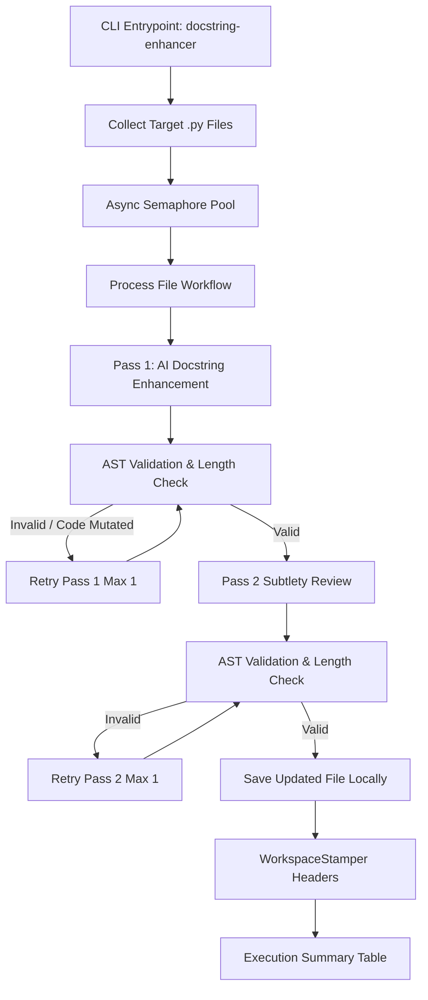

<!-- docs/designs/003-docstring-pipeline.md -->
<!-- SPDX-FileCopyrightText: Copyright (C) 2026 Sebastien Lenard <sebastien.lenard@gmail.com> and Contributors -->
<!-- SPDX-License-Identifier: Apache-2.0 -->

# 003: Docstring Enhancement and Correction Tool (`docstring-enhancer`) v0.1

## 1. Overview & Objectives
The `docstring-enhancer` utility is an asynchronous, concurrent AI-powered engine designed to audit, improve, and correct Python docstrings across project source files (`.py`). 

By enforcing concise, high-value docstrings (maximum 5 lines, omitting redundant type/exception annotations, and focusing on edge cases, state requirements, and usage subtleties), it allows Large Language Models (LLMs) to perform accurate code analysis and functionality assessments without reading full implementation bodies.

---

## 2. Architecture & Workflow Pipeline

The workflow coordinates target resolution, two-pass LLM remediation, AST structural validation, automated workspace compliance stamping, and synthetic reporting.

---

## 3. Key Components & Validation Engine

- **Target Resolution:** Requires a mandatory target path (file or directory). Recursively collects `.py` files while ignoring standard cache and virtual environment directories.
- **Two-Pass AI Pipeline (`GeminiClientAdapter`):**
  - **Pass 1 (Enhancement):** Prompts the LLM with the source file and `config/skills/docstring_enhancer.md` to refine docstrings.
  - **Pass 2 (Verification):** Sends the mutated file back to verify edge cases, usage subtleties, and ensure no critical context was omitted.
- **AST Structural Validator (`validate_docstring_mutations`):**
  - Parses both original and generated code into AST.
  - Strips all `ast.Constant` / `ast.Expr` docstring nodes from both trees.
  - Compares `ast.unparse()` output to mathematically guarantee that **zero** business logic, statements, signatures, or variable names were mutated.
  - Enforces the strict **max 5-line limit** on every docstring.
- **Workspace Compliance Integration (`WorkspaceStamper`):** Automatically re-runs path stamping and SPDX license header verification on the saved files to preserve legal compliance.

---

## 4. Logging & Synthetic Reporting
- **Standardized Traceability:** Log entries include file-specific context prefixes (e.g., `[workspace_guard]`) while omitting redundant log label repetition.
- **Tabular Execution Summary:** Outputs a formatted console table with explicit column headers (`File | Status | Stage`) utilizing project-relative file paths for clarity.
